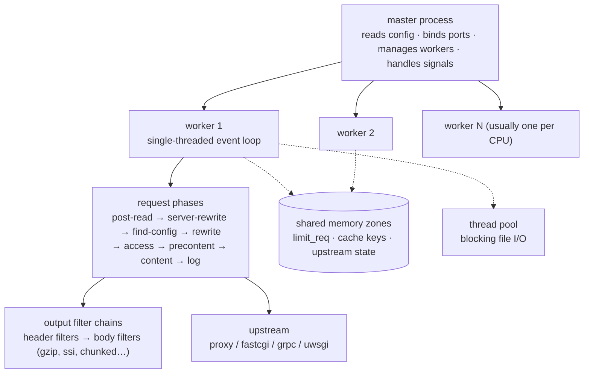
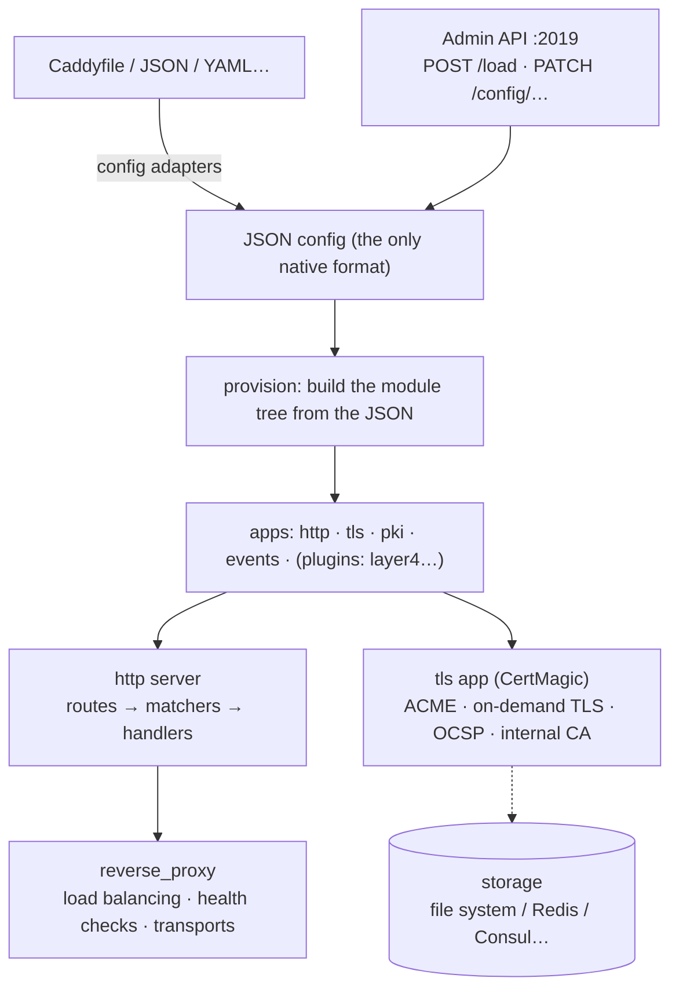
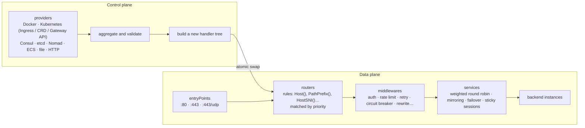

# nginx, Caddy and Traefik compared, and what it means for fit

[English](comparison.md) | [简体中文](comparison.zh-CN.md)

fit is planned as a server built on [fib](https://github.com/lesismal/fib), in the same space as
nginx, Caddy and Traefik: reverse proxy, load balancer, TLS terminator, static file server and API
gateway. This document compares the architecture, features, strengths and weaknesses of the three,
and the last section says which of their designs fit should take, what fib already provides, and
what is still missing.

It draws on public material as of 2026, covering nginx 1.2x (open source), Caddy 2.x and
Traefik 3.x. All three move quickly; check the official documentation for any given version.

- [At a glance](#at-a-glance)
- [Architecture](#architecture)
  - [nginx](#nginx)
  - [Caddy](#caddy)
  - [Traefik](#traefik)
  - [How the three architectures differ](#how-the-three-architectures-differ)
- [Features](#features)
- [Strengths and weaknesses](#strengths-and-weaknesses)
- [What this means for fit](#what-this-means-for-fit)

## At a glance

| | nginx | Caddy | Traefik |
| --- | --- | --- | --- |
| Language | C | Go | Go |
| First release | 2004 | 2015 (rewritten as v2 in 2020) | 2016 |
| License | BSD-2-Clause (NGINX Plus is commercial) | Apache 2.0 | MIT (Traefik Enterprise / Hub are commercial) |
| Process model | a master and several single-threaded worker processes | one process, a goroutine per connection | one process, a goroutine per connection |
| Native configuration | its own DSL (`nginx.conf`) | JSON; Caddyfile and other formats are adapted to JSON | static (YAML/TOML/CLI/env) plus dynamic (providers) |
| Changing configuration | `nginx -s reload`: reread the config, replace the workers | Admin API (REST) swaps the whole config atomically | providers push changes, the routing tree is swapped live |
| Automatic HTTPS | traditionally external tools such as certbot; an official ACME module since 2025 (preview) | on by default, the headline feature | built in (certResolvers, ACME) |
| Extensions | C modules (compiled in or dynamic), njs, Lua (OpenResty) | Go modules, compiled in with xcaddy | Go plugins interpreted by Yaegi, WASM plugins |
| Typical use | high-performance edge proxy, static assets, classic deployments | small and medium sites, HTTPS out of the box | dynamic service discovery in containers and Kubernetes |

## Architecture

### nginx

- **Several processes, one event loop each.** The master process reads the config and binds the
  ports as root, then forks the workers, usually one per CPU. Each worker is single-threaded and
  drives all its connections with epoll or kqueue, never blocking. Workers share no heap; state
  that spans workers (rate-limit counters, cache indexes, upstream state) lives in shared memory
  zones.
- **Requests go through phases.** An HTTP request passes through about 11 phases (rewrite, access,
  content, log and others), and each module registers handlers in the phases it cares about. The
  response goes through two filter chains, header filters and body filters; gzip, SSI and chunked
  encoding are all filters.
- **Memory pools.** Each connection and each request has its own pool, freed as a whole when it
  ends, which avoids fragmentation and almost all per-object freeing.
- **Blocking work moves out.** Disk reads can block the event loop, so `aio threads` hands them to
  a thread pool.
- **Reload and binary upgrade.** On `reload` the master rereads the config and starts new workers
  with it; the old workers finish the connections they hold and exit. The `USR2` signal swaps in a
  new binary without closing the ports. The cost: every change rebuilds the workers, long-lived
  connections (WebSocket, gRPC streams) keep old workers alive for a long time, and two
  generations of processes sit in memory at once.
- **Layer 4 proxying.** The `stream` module proxies TCP and UDP, and `ssl_preread` routes by SNI.
- **Modules are compile-time.** A dynamic module must match the nginx version and build flags
  exactly. Logic usually goes into njs (a JavaScript subset) or OpenResty (LuaJIT).

### Caddy

- **Everything is a module.** The core only loads configuration and manages module lifecycles. The
  HTTP server, TLS and PKI are "apps", and each app is made of modules in namespaces
  (`http.handlers.*`, `http.matchers.*`, `tls.issuance.*` and so on). Modules register in `init`,
  and third-party modules are compiled into the binary with xcaddy.
- **JSON is the only native config.** Caddyfile, YAML, nginx configs and others are turned into
  JSON by config adapters, so configuration can be generated, compared and patched by programs.
- **The Admin API swaps config atomically.** A new config is fully provisioned first, and the old
  one is stopped only once that succeeds; if it fails, the old config stays. Listeners are
  reference-counted by address and reused, so a config change drops no connection and rebinds no
  port.
- **The HTTP handler chain.** Each server is a list of routes, and each route is a set of matchers
  (host, path, header, expressions and more) plus a chain of handlers. In a Caddyfile, a built-in
  ordering table decides the order directives run in, unless a `route` block states it.
- **Automatic HTTPS (CertMagic).** By default Caddy obtains and renews certificates for the domains
  in its config (Let's Encrypt, ZeroSSL), redirects HTTP to HTTPS and staples OCSP. It can issue
  certificates during the TLS handshake ("on-demand TLS"), and has an internal CA for intranet
  names and localhost. Certificate storage can be shared so several instances form a cluster.
- **The network stack is the standard library's.** HTTP/1 and HTTP/2 run on `net/http`, HTTP/3 on
  quic-go, and layer 4 proxying comes from the caddy-l4 plugin. The concurrency model is therefore
  Go's goroutine per connection.

### Traefik

- **Static and dynamic configuration are separate.** Static configuration (entryPoints, providers,
  logs, metrics) is fixed at startup; dynamic configuration (routers, middlewares, services, TLS)
  keeps arriving from providers at run time.
- **Providers are the core.** Traefik watches Docker events, the Kubernetes API, Consul, etcd and
  others, and generates routes as services come and go or change their labels, with no one editing
  a file. The providers' configs are merged into a new handler tree that atomically replaces the
  old one.
- **Four concepts make up the data plane.** entryPoint (listen address) → router (rule plus
  priority) → middleware chain → service (a load balancer, or a weighted, mirroring or failover
  combination) → backends. TCP and UDP have routers and services of their own, and TCP can be
  routed by `HostSNI`.
- **Operations built in.** A web dashboard, ACME (on lego), metrics for Prometheus, Datadog and
  OpenTelemetry, OpenTelemetry tracing and access logs all ship with it.
- **Plugins.** Plugins are distributed as Go source and interpreted by Yaegi, with no rebuild;
  since v3 WASM plugins work too. The price is slower execution and only a subset of Go.
- **The network stack is the standard library's** (`net/http`, quic-go), so the concurrency model
  is the same as Caddy's.

### How the three architectures differ

| | nginx | Caddy | Traefik |
| --- | --- | --- | --- |
| Unit of concurrency | event loop and callbacks; an idle connection is just a struct | goroutine; an idle connection still holds a stack and bufio buffers | as Caddy |
| Using many cores | many processes, one loop each | the Go scheduler | the Go scheduler |
| State shared across cores | shared memory zones, designed explicitly | ordinary memory | ordinary memory |
| Granularity of config changes | whole reload, processes rebuilt | whole swap, in process, listeners reused | increments from providers, handler tree swapped whole |
| Source of truth | files | JSON (file or API) | external systems (orchestrators, KV stores, files) |
| Reclaiming memory | pools, freed at the end of a request | Go GC | Go GC |
| Cost of an extension | high: C, compilation, ABI | medium: Go, rebuild required | low: Go source is the plugin, at a speed cost |

## Features

✓ built in; ◐ partial or commercial edition only; 🔌 third-party plugin or module; — not supported.

| Feature | nginx (open source) | Caddy | Traefik |
| --- | --- | --- | --- |
| HTTP/1.1, HTTP/2 | ✓ | ✓ | ✓ |
| HTTP/3 (QUIC) | ✓ (since 1.25) | ✓ (on by default) | ✓ (stable since v3) |
| h2c upstreams / gRPC proxying | ✓ `grpc_pass` | ✓ | ✓ |
| WebSocket proxying | ✓ (Upgrade headers set by hand) | ✓ automatic | ✓ automatic |
| TCP/UDP layer 4 proxying | ✓ `stream` | 🔌 caddy-l4 | ✓ TCP/UDP routers |
| TLS routing by SNI | ✓ `ssl_preread` | 🔌 caddy-l4 | ✓ `HostSNI` |
| Static files | ✓ the strongest (sendfile, open_file_cache) | ✓ (precompressed files, directory browsing) | — |
| FastCGI (PHP) | ✓ | ✓ `php_fastcgi` | — |
| Load-balancing policies | round robin, least_conn, ip_hash, hash, random (least_time needs Plus) | random, round robin, weighted round robin, least_conn, first, ip/uri/header/cookie/query hashing and more | weighted round robin; sticky sessions; mirroring and failover services |
| Active health checks | ◐ Plus only | ✓ | ✓ |
| Passive health checks | ✓ `max_fails` | ✓ | ◐ through the circuit breaker middleware |
| Dynamic upstreams | ◐ Plus API or Lua | ✓ Admin API, dynamic upstream modules | ✓ providers |
| Response caching | ✓ `proxy_cache`, mature and powerful | 🔌 cache-handler (Souin) | 🔌 (none built into the open source edition) |
| Rate and concurrency limits | ✓ `limit_req`, `limit_conn` | 🔌 caddy-ratelimit | ✓ RateLimit, InFlightReq |
| Authentication | Basic, `auth_request` subrequests (JWT needs Plus) | Basic, forward_auth | Basic, Digest, ForwardAuth |
| Rewrites and redirects | ✓ regexp `rewrite`, `return`, `map` | ✓ `rewrite`, `uri`, `redir` | ✓ ReplacePath(Regex), StripPrefix, RedirectRegex |
| Compression | gzip (brotli needs a third-party module) | gzip, zstd (brotli needs a plugin) | gzip, brotli, zstd |
| Automatic HTTPS (ACME) | ◐ external tools or the new ACME module | ✓ default, on-demand TLS, internal CA | ✓ certResolvers |
| mTLS | ✓ | ✓ | ✓ |
| Config changes without interruption | ◐ process-level reload | ✓ Admin API | ✓ providers |
| Kubernetes | ingress-nginx (community, retirement announced), F5 NGINX Ingress Controller | 🔌 community projects, little used | ✓ Ingress, CRD, Gateway API |
| Docker service discovery | — | 🔌 caddy-docker-proxy | ✓ labels are the config |
| Metrics | ◐ `stub_status` (full metrics need Plus) | ✓ Prometheus | ✓ Prometheus, Datadog, OTel and more |
| Tracing | 🔌 OTel module | ✓ OTel | ✓ OTel |
| Management UI | ◐ Plus dashboard | — | ✓ dashboard |
| Structured logs | ◐ JSON assembled with `log_format` | ✓ JSON (zap) | ✓ JSON |
| Scripting and plugins | C modules, njs, Lua (OpenResty) | Go modules (rebuild) | Yaegi Go plugins, WASM |

## Strengths and weaknesses

### nginx

**Strengths**

- The benchmark for speed and footprint: C, event-driven, memory pools; even huge numbers of idle
  connections take little memory.
- Extremely mature: two decades of large-scale production, and an answer to almost any question.
- The strongest static file serving and caching; `proxy_cache` holds up at CDN scale.
- Broad: HTTP, mail and stream; FastCGI, uwsgi and gRPC upstreams; regexp locations and `map`
  compose into a lot.
- A huge ecosystem: OpenResty, njs, many third-party modules, and default support in most
  operations tooling.

**Weaknesses**

- The config is a DSL of its own, with traps in `if`, `location` matching order and inheritance,
  and it is hard to generate or validate by program.
- Changes need a process reload, and the open source edition lacks dynamic upstreams, active
  health checks, full metrics and JWT, which take Plus or Lua.
- No automatic HTTPS out of the box; for a long time that meant certbot or similar.
- Extending it is hard: C modules must be compiled against the right version, and their memory
  safety is up to their authors.
- With many processes, state shared across workers must go through shared memory, which makes
  rate limiting, session affinity and the like harder to implement and configure.
- HTTP/3 arrived late and is less mature than its other protocols.

### Caddy

**Strengths**

- Secure by default: certificates obtained and renewed automatically, HTTP redirected to HTTPS,
  modern TLS settings, live with almost no configuration.
- Simple to configure: a Caddyfile is short and readable, and JSON underneath is strict and
  programmable.
- The Admin API makes config changes atomic, reversible and uninterrupted, which suits automation
  better than a process reload.
- A clean modular architecture; extensions in Go are easy to write, type-safe and memory-safe.
- Strong certificate management: on-demand TLS, an internal CA, clusters on shared storage, suited
  to SaaS custom domains and similar.
- One static binary with no external dependencies.

**Weaknesses**

- On `net/http`, a goroutine per connection costs clearly more memory and GC than nginx at high
  connection counts.
- Plugins need a rebuild with xcaddy and cannot be loaded at run time; distributed binaries and
  custom builds can drift apart.
- Caching, rate limiting and layer 4 proxying rely on third-party plugins of uneven maturity.
- Service discovery and Kubernetes support are weak; on an orchestrator it fits less naturally
  than Traefik.
- The implicit directive order of a Caddyfile can surprise, and complex setups fall back to JSON
  or explicit `route` blocks.

### Traefik

**Strengths**

- Built for dynamic environments: Docker labels and Kubernetes CRDs or Gateway API resources are
  the config, and services take effect as they come and go.
- Comprehensive out of the box: ACME, dashboard, metrics, tracing, rate limiting, circuit
  breakers, retries and ForwardAuth.
- A clear model (entryPoint → router → middleware → service), the same for HTTP, TCP and UDP.
- Plugins ship as source and need no rebuild.
- One of the most common choices for Kubernetes Ingress and Gateway.

**Weaknesses**

- Usually the slowest and largest of the three: the standard library's network stack, plus a deep
  handler chain and many layers of abstraction.
- Not a web server: no static files, no FastCGI, no built-in cache.
- Configuration is spread across static config, dynamic config, provider labels and CRDs, and
  debugging means understanding how the layers merge.
- Major versions (v1 → v2 → v3) broke compatibility more than once, and migrations are costly.
- Yaegi plugins are interpreted, slow and limited to a subset of Go; some advanced features are
  commercial only.

## What this means for fit

### Where fib stands

fib's concurrency model is close to nginx's, and its programming model close to Caddy's and
Traefik's:

- **Like nginx**, it uses event loops and callbacks: an idle connection holds no goroutine, read
  and write buffers are borrowed for one round only, and a write watermark and a server-wide budget
  for pending bytes apply backpressure. This is exactly where Caddy and Traefik fall behind nginx
  in memory.
- **Unlike nginx**, fib works in one process with a shared worker pool. No connection is tied to a
  thread, load spreads by real work, and state shared across cores is ordinary memory. Where heaps
  and collectors should be isolated, `prefork` runs one process per CPU, as nginx does, sharing the
  ports through `SO_REUSEPORT`.
- **Like Caddy and Traefik**, it is Go: one static binary, memory-safe, and HTTP handlers take the
  standard `*http.Request` and `http.ResponseWriter`, so much of the Go ecosystem can be reused.

### What fib already provides

| Capability | In fib | What it gives fit |
| --- | --- | --- |
| HTTP/1.x, HTTP/2, HTTP/3, WebSocket (also over h2 and h3), gRPC | the protocol packages | protocol coverage no weaker than the three, HTTP/3 without quic-go |
| Several protocols on one port | `mux` and `multiproto`, told apart by the first bytes | none of the three has it: HTTP, TLS, gRPC, SOCKS and custom protocols on one port |
| A base for layer 4 proxying | raw TCP/UDP handlers, `Connection.HoldReads`, backpressure | TCP/UDP proxying like nginx's `stream` |
| TLS termination | `fib/tls`, the `GetCertificate` callback (which may block, on a pool of its own) | ACME (autocert, CertMagic, lego) for automatic HTTPS |
| Listeners added and removed at run time | `AddBinding`, `RemoveBinding`, `ShutdownBinding` | listener changes and graceful draining of one listener, in process, without an nginx-style reload |
| Changing a connection's handler | `Connection.SetHandler` | handing over after protocol detection or an upgrade |
| Asynchronous clients | HTTP/1.x, HTTP/2, HTTP/3 and WebSocket clients, with connection pools and streamed bodies | the base for upstreams |
| CONNECT and SOCKS | `ConnectProxy`, `socks` | forward proxying; none of the three has SOCKS built in |
| Static files | `http.FileCache` (in memory, precompressed twins, inotify), sendfile | static serving close to nginx's, which Traefik lacks |
| Routing and middleware | a chi-style Router; compress, cors, limiter, logger and other middleware | route matching and the common middleware |
| Several processes | `prefork` | an optional nginx-style deployment |

### What fit has to build

1. **Reverse proxy and upstreams.** fib has no reverse proxy. fit needs one on fib's asynchronous
   clients: upstream connection pools, request and response bodies streamed both ways,
   backpressure linked across the two sides (`HoldReads` the upstream while the client is slow,
   and the other way round), timeouts, retries, and `X-Forwarded-*` / `Forwarded` headers. fib
   does not implement `http.Hijacker`, so `httputil.ReverseProxy`'s WebSocket upgrade path does not
   work, and `Request.Context()` is not cancelled when the client goes away. fit should therefore
   have a proxy of its own, handle upgrades with `Context.Upgrade` and `Tunnel`, and propagate
   cancellation with `c.Context()`. Any blocking call on the proxy path holds a worker, so the
   path must stay asynchronous.
2. **Load balancing and health checks.** At least round robin, weighted round robin, least
   connections, consistent hashing and P2C, with both active and passive health checks (nginx open
   source has only passive ones, a common complaint).
3. **Configuration.** Take Caddy's approach: one strict, programmable native format (JSON or YAML,
   with schema validation), and friendlier formats converted by adapters. A converter for a subset
   of nginx configs would ease migration.
4. **Dynamic configuration and a control plane.** Combine Caddy and Traefik:
   - an Admin API that loads, patches and rolls back configs, building a new config whole and only
     then swapping it in atomically;
   - providers: file watching, Docker, Kubernetes (Gateway API first), Consul and etcd;
   - an immutable routing graph at run time, replaced through an atomic pointer, with connections
     already on the old graph finishing there where needed.
5. **Automatic HTTPS.** Take Caddy's approach: ACME on by default, automatic renewal, OCSP stapling,
   on-demand TLS and shared certificate storage. fib depends only on the standard library; fit can
   bring in CertMagic or lego, or write its own to keep dependencies lean.
6. **Caching.** nginx's `proxy_cache` is where Caddy and Traefik are clearly weak, which makes it a
   chance for fit to stand out: a memory and disk tier, cache locks against stampedes,
   stale-while-revalidate, and purging by key.
7. **Observability.** Prometheus metrics, OpenTelemetry tracing and structured access logs from the
   start, plus a read-only dashboard like Traefik's.
8. **Extensions.** Each of the three trades something: nginx's C modules are fast but hard, Caddy's
   Go modules are safe but need a rebuild, Traefik's interpreted plugins are convenient but slow.
   fit can have two tiers: compile-time Go modules for handlers where speed matters, and WASM
   plugins, loaded at run time and sandboxed, for business logic.

### Design recommendations

- **Keep fib's model in the data plane.** Bring no goroutine per connection or per request into
  the request path, or fit loses its memory advantage over Caddy and Traefik. Extension points that
  must block (external auth, plugin calls) go to pools of their own, as fib does with its TLS
  handshake pool and streams pools, and waits go only one way, so the pools cannot deadlock each
  other.
- **Separate the control plane from the data plane.** Config parsing, provider watches and
  certificate issuance run in the control plane and produce immutable runtime objects that the data
  plane only reads. A config change then cannot disturb requests in flight, and both sides are easy
  to test.
- **Take Traefik's model**: listener (entryPoint) → router → middleware → service → upstream, the
  same concepts for HTTP and for TCP/UDP; on top of it, fib's `mux` lets a listener split traffic
  by protocol as well.
- **Take Caddy's defaults**: HTTPS by default, sensible TLS parameters, and limits on header and
  body sizes by default.
- **Take nginx's bar for static files, caching and speed**: this is where Go servers in this space
  are usually weak, and where fit, on fib, has the best chance of beating them.

### Suggested milestones

1. **M1, the proxy core**: config file loading, HTTP/1, HTTP/2 and HTTP/3 entry points, static files,
   reverse proxying, round robin and least connections, passive health checks, access logs.
2. **M2, dynamic config and TLS**: the Admin API and atomic config swaps, ACME automatic HTTPS,
   active health checks, Prometheus metrics.
3. **M3, gateway features**: rate limiting, authentication (Basic, ForwardAuth, JWT), retries and
   circuit breaking, WebSocket and gRPC proxying, TCP/UDP layer 4 proxying with SNI routing.
4. **M4, platform integration**: Docker and Kubernetes Gateway API providers, a dashboard,
   OpenTelemetry tracing.
5. **M5, caching and extensions**: a two-tier response cache, WASM plugins, an nginx config
   converter.

The [roadmap](roadmap.md) expands these milestones with scope, exit criteria and performance
targets.
