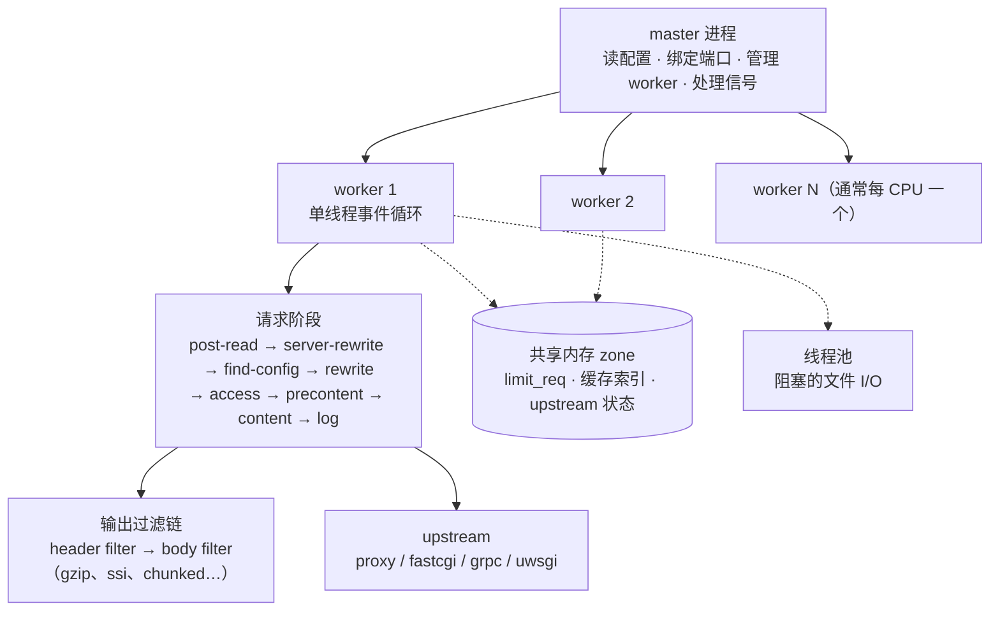
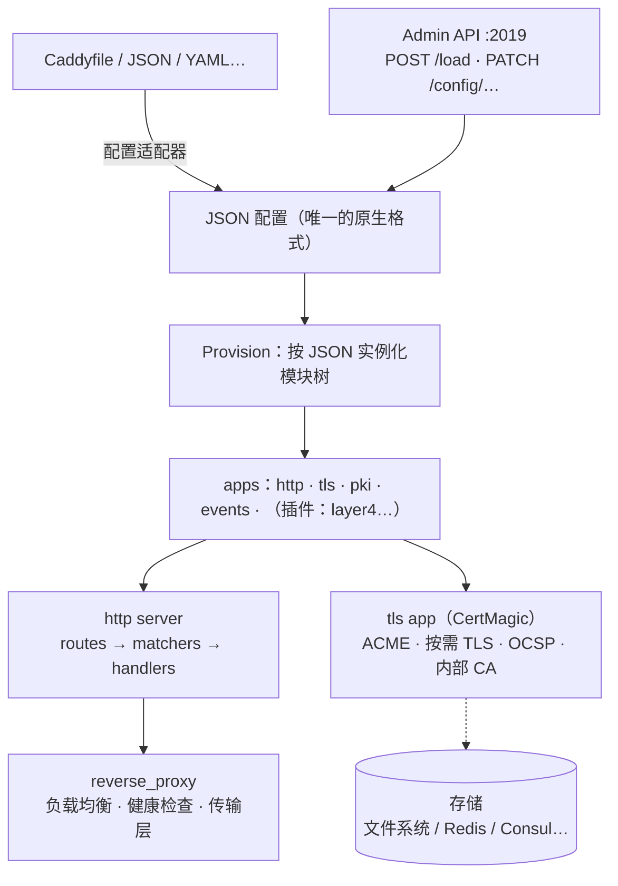
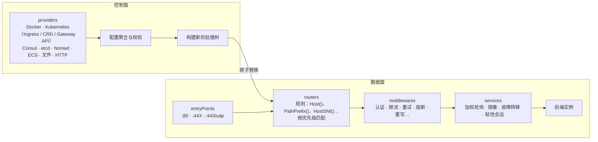

# nginx、Caddy、Traefik 对比，以及对 fit 的启示

[English](comparison.md) | [简体中文](comparison.zh-CN.md)

fit 计划基于 [fib](https://github.com/lesismal/fib) 开发，定位与 nginx、Caddy、Traefik 相同：
反向代理、负载均衡、TLS 终结、静态文件服务和 API 网关。本文对比这三个软件的架构、功能和优缺点，
最后一节说明哪些设计 fit 应该借鉴、fib 已经提供了什么、还缺什么。

本文依据截至 2026 年的公开资料，对应 nginx 1.2x（开源版）、Caddy 2.x 和 Traefik 3.x。
各项目更新很快，具体版本的细节请以官方文档为准。

- [一览](#一览)
- [架构](#架构)
  - [nginx](#nginx)
  - [Caddy](#caddy)
  - [Traefik](#traefik)
  - [三种架构的差异](#三种架构的差异)
- [功能对比](#功能对比)
- [优缺点](#优缺点)
- [对 fit 的启示](#对-fit-的启示)

## 一览

| | nginx | Caddy | Traefik |
| --- | --- | --- | --- |
| 语言 | C | Go | Go |
| 首次发布 | 2004 | 2015（v2 于 2020 年重写） | 2016 |
| 许可证 | BSD-2-Clause（另有商业版 NGINX Plus） | Apache 2.0 | MIT（另有商业版 Traefik Enterprise / Hub） |
| 进程模型 | master + 多个单线程 worker 进程 | 单进程，每连接一个 goroutine | 单进程，每连接一个 goroutine |
| 原生配置 | 自有 DSL（`nginx.conf`） | JSON；Caddyfile 等格式经适配器转成 JSON | 静态配置（YAML/TOML/CLI/环境变量）+ 动态配置（provider） |
| 改配置 | `nginx -s reload`：重读配置，换一批 worker | Admin API（REST）原子替换整份配置 | provider 推送变化，路由表热替换 |
| 自动 HTTPS | 传统上依赖 certbot 等外部工具；2025 年起官方提供 ACME 模块（预览） | 默认开启，核心卖点 | 内置 certResolver（ACME） |
| 扩展方式 | C 模块（编译期或动态模块）、njs、Lua（OpenResty） | Go 模块，用 xcaddy 编译进二进制 | Yaegi 解释执行的 Go 插件、WASM 插件 |
| 典型场景 | 高性能边缘代理、静态资源、传统部署 | 中小规模站点、开箱即用的 HTTPS | 容器与 Kubernetes 中的动态服务发现 |

## 架构

### nginx

- **多进程、每进程一个事件循环。** master 进程以 root 读配置、绑定端口，然后 fork 出若干 worker
  （通常每 CPU 一个）。每个 worker 是单线程，用 epoll/kqueue 驱动所有连接，全程非阻塞。worker
  之间不共享堆，跨 worker 的状态（限流计数、缓存索引、upstream 状态）放在共享内存 zone 里。
- **请求按阶段处理。** HTTP 请求依次经过约 11 个阶段（rewrite、access、content、log 等），每个模块
  在自己关心的阶段注册 handler。响应经过 header filter 和 body filter 两条过滤链，gzip、SSI、
  分块编码都是过滤器。
- **内存池。** 每个连接和请求有自己的内存池，请求结束整体释放，避免碎片，也几乎没有逐对象的释放开销。
- **阻塞操作外移。** 磁盘读取可能阻塞事件循环，`aio threads` 把它交给线程池。
- **配置重载与二进制升级。** `reload` 时 master 重读配置，用新配置启动新 worker，旧 worker 处理完
  手上的连接再退出。`USR2` 信号可在不断开端口的情况下换成新二进制。代价是：每次改动都要重建 worker，
  长连接（WebSocket、gRPC 流）会挂在旧 worker 上很久，内存里同时存在两代进程。
- **四层代理。** `stream` 模块提供 TCP/UDP 代理，`ssl_preread` 可按 SNI 分流。
- **模块是编译期的。** 动态模块需要与 nginx 版本和编译参数严格匹配。需要逻辑的场景通常用 njs
  （JavaScript 子集）或 OpenResty（LuaJIT）。

### Caddy

- **一切皆模块。** 核心只负责加载配置和管理模块生命周期。HTTP 服务器、TLS、PKI 都是"app"，
  每个 app 又由命名空间下的模块组成（`http.handlers.*`、`http.matchers.*`、`tls.issuance.*` 等）。
  模块在 `init` 时注册，第三方模块用 xcaddy 编译进二进制。
- **JSON 是唯一的原生配置。** Caddyfile、YAML、nginx 配置等都通过"配置适配器"转成 JSON。
  这让配置可以被程序生成、比较和局部修改。
- **Admin API 原子替换配置。** 新配置先完整 provision，成功后再停掉旧配置；失败则保持旧配置不变。
  监听器按地址引用计数复用，所以换配置不丢连接、不重新绑定端口。
- **HTTP 处理链。** 每个 server 是一组 route，每条 route 是 matcher（host、path、header、表达式等）
  加一串 handler。Caddyfile 中指令的执行顺序由内置的排序表决定，也可以用 `route` 块显式指定。
- **自动 HTTPS（CertMagic）。** 默认为配置里出现的域名申请和续期证书（Let's Encrypt、ZeroSSL），
  自动 HTTP→HTTPS 跳转、OCSP stapling；支持在 TLS 握手时才签发的"按需 TLS"，以及给内网和
  localhost 签证书的内部 CA。证书存储可以换成共享存储，让多个实例组成集群。
- **网络栈基于标准库。** HTTP/1 和 HTTP/2 用 `net/http`，HTTP/3 用 quic-go，四层代理靠
  caddy-l4 插件。因此并发模型就是 Go 的每连接一个 goroutine。

### Traefik

- **静态配置与动态配置分离。** 静态配置（entryPoints、providers、日志、指标）在启动时确定；
  动态配置（routers、middlewares、services、TLS）由 provider 在运行时持续提供。
- **Provider 是核心。** Traefik 监听 Docker 事件、Kubernetes API、Consul/etcd 等，服务上下线或标签
  变化时自动生成路由，不需要人去改配置文件。各 provider 的配置聚合后构建一棵新的 handler 树，
  原子地替换掉旧的。
- **四个概念组成数据面。** entryPoint（监听地址）→ router（匹配规则 + 优先级）→ middleware 链 →
  service（负载均衡器或加权/镜像/故障转移组合）→ 后端。TCP 和 UDP 也有对应的 router 和 service，
  TCP 可按 `HostSNI` 分流。
- **内置运维能力。** 自带 Web 仪表盘、ACME（基于 lego）、Prometheus/Datadog/OpenTelemetry 指标、
  OpenTelemetry 链路追踪、访问日志。
- **插件。** 插件以 Go 源码形式分发，由 Yaegi 解释执行，不需要重新编译；v3 起也支持 WASM 插件。
  代价是解释执行较慢，且只能用 Go 语言的一个子集。
- **网络栈同样基于标准库**（`net/http`、quic-go），并发模型与 Caddy 相同。

### 三种架构的差异

| | nginx | Caddy | Traefik |
| --- | --- | --- | --- |
| 并发单元 | 事件循环 + 回调，空闲连接只占一个结构体 | goroutine，空闲连接也占一个栈和 bufio 缓冲 | 同 Caddy |
| 多核利用 | 多进程，每进程一个循环 | Go 调度器 | Go 调度器 |
| 跨核共享状态 | 共享内存 zone，需要显式设计 | 普通内存 | 普通内存 |
| 配置变更粒度 | 整体重载，重建进程 | 整体替换，进程内完成，监听器复用 | 增量来自 provider，处理树整体替换 |
| 配置的"真相" | 文件 | JSON（文件或 API） | 外部系统（编排平台、KV、文件） |
| 内存回收 | 内存池，请求结束整体释放 | Go GC | Go GC |
| 扩展的门槛 | 高：C、编译、ABI | 中：Go、需要重新编译 | 低：Go 源码即插件，但性能受限 |

## 功能对比

✓ 内置；◐ 部分支持或需要商业版；🔌 需要第三方插件/模块；— 不支持。

| 功能 | nginx（开源） | Caddy | Traefik |
| --- | --- | --- | --- |
| HTTP/1.1、HTTP/2 | ✓ | ✓ | ✓ |
| HTTP/3（QUIC） | ✓（1.25 起） | ✓（默认开启） | ✓（v3 起稳定） |
| h2c 上游 / gRPC 代理 | ✓ `grpc_pass` | ✓ | ✓ |
| WebSocket 代理 | ✓（需手写 Upgrade 头） | ✓ 自动 | ✓ 自动 |
| TCP/UDP 四层代理 | ✓ `stream` | 🔌 caddy-l4 | ✓ TCP/UDP router |
| 按 SNI 分流 TLS | ✓ `ssl_preread` | 🔌 caddy-l4 | ✓ `HostSNI` |
| 静态文件 | ✓ 最强（sendfile、open_file_cache） | ✓（含预压缩文件、目录浏览） | — |
| FastCGI（PHP） | ✓ | ✓ `php_fastcgi` | — |
| 负载均衡算法 | 轮询、least_conn、ip_hash、hash、random（least_time 需 Plus） | random、轮询、加权轮询、least_conn、first、ip/uri/header/cookie/query 哈希等 | 加权轮询；粘性会话；镜像、故障转移等组合 service |
| 主动健康检查 | ◐ 仅 Plus | ✓ | ✓ |
| 被动健康检查 | ✓ `max_fails` | ✓ | ◐ 通过熔断中间件 |
| 动态上游 | ◐ 需 Plus API 或 Lua | ✓ Admin API、动态上游模块 | ✓ provider |
| 响应缓存 | ✓ `proxy_cache`，成熟强大 | 🔌 cache-handler（Souin） | 🔌（开源版无内置） |
| 限流 / 并发限制 | ✓ `limit_req`、`limit_conn` | 🔌 caddy-ratelimit | ✓ RateLimit、InFlightReq |
| 认证 | Basic、`auth_request` 子请求（JWT 需 Plus） | Basic、forward_auth | Basic、Digest、ForwardAuth |
| 重写 / 跳转 | ✓ 正则 `rewrite`、`return`、`map` | ✓ `rewrite`、`uri`、`redir` | ✓ ReplacePath(Regex)、StripPrefix、RedirectRegex |
| 压缩 | gzip（brotli 需第三方模块） | gzip、zstd（brotli 需插件） | gzip、brotli、zstd |
| 自动 HTTPS（ACME） | ◐ 外部工具或新 ACME 模块 | ✓ 默认、按需 TLS、内部 CA | ✓ certResolver |
| mTLS | ✓ | ✓ | ✓ |
| 无中断改配置 | ◐ 进程级重载 | ✓ Admin API | ✓ provider |
| Kubernetes | ingress-nginx（社区版已宣布退役）、F5 NGINX Ingress Controller | 🔌 社区方案，较少使用 | ✓ Ingress、CRD、Gateway API |
| Docker 服务发现 | — | 🔌 caddy-docker-proxy | ✓ 标签即配置 |
| 指标 | ◐ `stub_status`（完整指标需 Plus） | ✓ Prometheus | ✓ Prometheus、Datadog、OTel 等 |
| 链路追踪 | 🔌 OTel 模块 | ✓ OTel | ✓ OTel |
| 管理界面 | ◐ Plus 仪表盘 | — | ✓ 仪表盘 |
| 结构化日志 | ◐ 自定义 `log_format` 拼 JSON | ✓ JSON（zap） | ✓ JSON |
| 脚本 / 插件 | C 模块、njs、Lua（OpenResty） | Go 模块（重新编译） | Yaegi Go 插件、WASM |

## 优缺点

### nginx

**优点**

- 性能和资源占用的标杆：C 实现、事件驱动、内存池，海量空闲连接也只占很少内存。
- 极其成熟：近二十年大规模生产验证，几乎任何问题都有现成答案。
- 静态文件和缓存能力最强，`proxy_cache` 足以支撑 CDN 级别的场景。
- 功能面广：HTTP、mail、stream，FastCGI/uwsgi/gRPC 上游，正则路由和 `map` 等组合能力。
- 生态庞大：OpenResty、njs、大量第三方模块，以及各种运维工具链的默认支持。

**缺点**

- 配置是一门独立的 DSL，`if`、`location` 匹配顺序、继承规则等有不少陷阱，难以程序化生成和校验。
- 改配置要重载进程；动态上游、主动健康检查、完整指标、JWT 等常用能力在开源版里缺失，需要 Plus 或 Lua。
- 不提供开箱即用的自动 HTTPS，长期依赖 certbot 等外部工具。
- 扩展门槛高：C 模块需要编译并匹配版本，内存安全问题也由模块作者自己负责。
- 多进程模型下跨 worker 共享状态必须走共享内存，限流、会话保持等功能的实现和配置都更复杂。
- HTTP/3 支持起步晚，相对其他协议成熟度较低。

### Caddy

**优点**

- 默认安全：自动申请和续期证书、自动跳转 HTTPS、默认启用较新的 TLS 配置，零配置即可上线。
- 配置简单：Caddyfile 短小易读；同时有 JSON 作为严格、可程序化的底层格式。
- Admin API 让配置变更原子、可回滚、不中断连接，比进程级重载更适合自动化。
- 模块化架构清晰，用 Go 写扩展门槛低，类型安全，内存安全。
- 证书管理能力强：按需 TLS、内部 CA、共享存储集群，适合 SaaS 自定义域名等场景。
- 单个静态二进制，无外部依赖，部署简单。

**缺点**

- 基于 `net/http`，每连接一个 goroutine，高连接数时内存和 GC 开销明显高于 nginx。
- 插件需要用 xcaddy 重新编译，无法在运行时加载；发行版二进制和自定义构建可能不一致。
- 缓存、限流、四层代理等依赖第三方插件，成熟度参差不齐。
- 原生的服务发现和 Kubernetes 支持较弱，在容器编排环境中不如 Traefik 自然。
- Caddyfile 指令的隐式执行顺序有时出乎意料，复杂场景需要回到 JSON 或显式 `route`。

### Traefik

**优点**

- 为动态环境而生：Docker 标签、Kubernetes CRD/Gateway API 即配置，服务上下线自动生效。
- 内置功能全面：ACME、仪表盘、指标、追踪、限流、熔断、重试、ForwardAuth 都开箱即用。
- 概念模型清晰（entryPoint → router → middleware → service），HTTP、TCP、UDP 统一。
- 插件以源码分发，不需要重新编译。
- 在 Kubernetes Ingress / Gateway 领域是最常见的选择之一。

**缺点**

- 性能和内存占用在三者中通常最差：标准库网络栈，加上较深的处理链和大量抽象。
- 不是 Web 服务器：不服务静态文件，不支持 FastCGI，也没有内置缓存。
- 配置分散在静态配置、动态配置、provider 标签和 CRD 之间，排错时需要理解多层合并规则。
- 版本大升级（v1→v2→v3）多次破坏性变更，迁移成本高。
- Yaegi 插件是解释执行，性能有限，只支持 Go 的一个子集；部分高级功能在商业版中。

## 对 fit 的启示

### fib 的位置

fib 的并发模型与 nginx 相近，开发体验与 Caddy、Traefik 相近：

- **与 nginx 相同**的是事件循环 + 回调：空闲连接不占 goroutine，读写缓冲只在一轮处理中借用，
  有写水位和全局待发字节预算做背压。这正是 Caddy、Traefik 在内存上落后于 nginx 的地方。
- **与 nginx 不同**的是 fib 在一个进程里用共享 worker 池做事，连接不绑定线程，负载按实际工作量分配，
  跨核共享状态就是普通内存。需要隔离堆和 GC 时，`prefork` 可以像 nginx 那样每 CPU 一个进程，
  通过 `SO_REUSEPORT` 共享端口。
- **与 Caddy、Traefik 相同**的是 Go 语言、单个静态二进制、内存安全，HTTP handler 使用标准的
  `*http.Request` 和 `http.ResponseWriter`，可以复用 Go 生态的大量代码。

### fib 已经提供、可直接利用的能力

| 能力 | fib 中的对应 | 对 fit 的意义 |
| --- | --- | --- |
| HTTP/1.x、HTTP/2、HTTP/3、WebSocket（含 over h2/h3）、gRPC | 各协议包 | 协议覆盖不弱于三者，HTTP/3 无需 quic-go |
| 一个端口多种协议 | `mux`、`multiproto` 按首字节识别 | 三者都没有的能力：同一端口同时服务 HTTP、TLS、gRPC、SOCKS、自定义协议 |
| 四层代理基础 | 原始 TCP/UDP handler、`Connection.HoldReads`、背压 | 可实现类似 nginx `stream` 的 TCP/UDP 代理 |
| TLS 终结 | `fib/tls`、`GetCertificate` 回调（握手可在独立池中阻塞） | 可接入 ACME（如 autocert、CertMagic、lego）实现自动 HTTPS |
| 运行时增删监听 | `AddBinding`、`RemoveBinding`、`ShutdownBinding` | 进程内完成监听变更和单个监听的优雅下线，无需 nginx 式的进程重载 |
| 切换连接的处理器 | `Connection.SetHandler` | 协议识别、升级后交接 |
| 异步客户端 | HTTP/1.x、HTTP/2、HTTP/3、WebSocket 客户端，连接池、流式响应体 | 反向代理上游的基础 |
| CONNECT、SOCKS | `ConnectProxy`、`socks` | 正向代理能力，三者都不内置 SOCKS |
| 静态文件 | `http.FileCache`（内存缓存、预压缩、inotify）、sendfile | 接近 nginx 的静态文件能力，Traefik 没有 |
| 路由与中间件 | chi 风格 Router，compress、cors、limiter、logger 等中间件 | 路由匹配和常用中间件 |
| 多进程 | `prefork` | 可选的 nginx 式部署 |

### fit 需要自己构建的部分

1. **反向代理与上游管理。** fib 没有内置反向代理。fit 需要基于 fib 的异步客户端实现：
   上游连接池、请求体和响应体双向流式转发、两侧背压联动（下游慢时 `HoldReads` 上游，反之亦然）、
   超时、重试、`X-Forwarded-*` / `Forwarded` 头处理。注意 fib 不支持 `http.Hijacker`，
   `httputil.ReverseProxy` 的 WebSocket 升级路径用不了，且 `Request.Context()` 不会因客户端断开而取消，
   所以 fit 应该写自己的代理，用 `Context.Upgrade` / `Tunnel` 处理升级，用 `c.Context()` 传播取消。
   代理路径上的任何阻塞调用都会占住 worker，必须保持异步。
2. **负载均衡与健康检查。** 至少提供轮询、加权轮询、最少连接、一致性哈希、P2C，
   并同时提供主动和被动健康检查（nginx 开源版只有被动，这是常见痛点）。
3. **配置系统。** 建议学习 Caddy：一个严格、可程序化的原生格式（JSON/YAML，带 schema 校验），
   人类友好的格式通过适配器转换；可选提供 nginx 配置的子集转换器以降低迁移成本。
4. **动态配置与控制面。** 结合 Caddy 和 Traefik：
   - Admin API：加载、局部修改、回滚配置，配置先完整构建，成功后再原子替换；
   - Provider：文件监听、Docker、Kubernetes（Gateway API 优先）、Consul/etcd；
   - 运行时用不可变的路由图，构建新图后用原子指针替换，旧连接按需在旧图上处理完。
5. **自动 HTTPS。** 学习 Caddy：默认开启 ACME、自动续期、OCSP stapling、按需 TLS、共享证书存储。
   fib 本身只依赖标准库；fit 可以选择引入 CertMagic 或 lego，也可以自研以保持依赖精简。
6. **缓存。** nginx `proxy_cache` 是 Caddy 和 Traefik 的明显短板，也是 fit 的差异化机会：
   内存 + 磁盘两级缓存、缓存锁（防击穿）、stale-while-revalidate、按键清除。
7. **可观测性。** 从一开始就内置 Prometheus 指标、OpenTelemetry 追踪、结构化访问日志，
   以及类似 Traefik 的只读仪表盘。
8. **扩展机制。** 三者各有取舍：nginx 的 C 模块性能好但门槛高，Caddy 的 Go 模块安全但需重编译，
   Traefik 的解释执行插件方便但慢。fit 可以分两层：编译期 Go 模块（性能敏感的 handler）
   + WASM 插件（运行时加载、沙箱隔离，适合业务逻辑）。

### 设计建议

- **数据面保持 fib 的模型。** 不要在请求路径上引入每连接或每请求的 goroutine，否则会失去相对
  Caddy、Traefik 的内存优势。需要阻塞的扩展点（外部认证、插件调用）放到独立的池里，
  与 fib 中 TLS 握手池、streams 池的做法一致，并保持"等待只能单向"以避免池之间死锁。
- **控制面与数据面分离。** 配置解析、provider 监听、证书申请都在控制面，产出不可变的运行时对象，
  数据面只读。这样配置变更不影响正在处理的请求，也容易测试。
- **概念模型参考 Traefik**：listener（entryPoint）→ router → middleware → service → upstream，
  HTTP 和 TCP/UDP 共用同一套概念；在此基础上利用 fib 的 `mux`，让 listener 可以按协议再分流。
- **默认安全参考 Caddy**：默认 HTTPS、默认合理的 TLS 参数、默认限制请求头和请求体大小。
- **静态文件、缓存和性能参考 nginx**：这是 Go 实现的同类软件普遍薄弱的地方，也是 fit 基于 fib
  最有可能超越它们的地方。

### 建议的里程碑

1. **M1 反向代理核心**：配置文件加载、HTTP/1/2/3 入口、静态文件、反向代理、轮询和最少连接、
   被动健康检查、访问日志。
2. **M2 动态与 TLS**：Admin API 与原子配置替换、ACME 自动 HTTPS、主动健康检查、Prometheus 指标。
3. **M3 网关能力**：限流、认证（Basic、ForwardAuth、JWT）、重试与熔断、WebSocket 和 gRPC 代理、
   TCP/UDP 四层代理与 SNI 分流。
4. **M4 平台集成**：Docker 与 Kubernetes Gateway API provider、仪表盘、OpenTelemetry 追踪。
5. **M5 缓存与扩展**：两级响应缓存、WASM 插件、nginx 配置转换器。

[路线图](roadmap.zh-CN.md) 在这些里程碑的基础上展开了范围、退出标准和性能目标。
