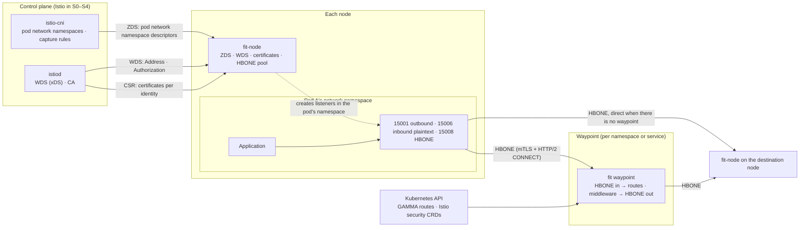

# fit service mesh data plane roadmap

[English](mesh-roadmap.md) | [简体中文](mesh-roadmap.zh-CN.md)

This roadmap plans fit as the data plane of a modern cloud-native service mesh: the per-node layer 4
proxy and the layer 7 waypoint proxy of the sidecarless (ambient) architecture. It is a track of
its own beside the [gateway roadmap](roadmap.md): it reuses the gateway's data plane, but has its
own milestones, exit criteria and [development plan](mesh-dev-plan.md).

As in the gateway roadmap, there are no dates: a milestone ends when its exit criteria are met. The
[development rules](rules.md) bind every change here too.

- [Why](#why)
- [Choices: ambient first](#choices-ambient-first)
- [Goals](#goals)
- [Non-goals](#non-goals)
- [Design principles](#design-principles)
- [Architecture](#architecture)
- [Relation to the gateway roadmap](#relation-to-the-gateway-roadmap)
- [Milestones](#milestones)
  - [S0 Groundwork and baseline](#s0-groundwork-and-baseline)
  - [S1 Identity and HBONE](#s1-identity-and-hbone)
  - [S2 Node proxy](#s2-node-proxy)
  - [S3 Waypoint](#s3-waypoint)
  - [S4 Operations and resilience](#s4-operations-and-resilience)
  - [S5 Standalone mode and multiple networks](#s5-standalone-mode-and-multiple-networks)
  - [Mesh 1.0](#mesh-10)
- [What fib needs to provide](#what-fib-needs-to-provide)
- [Performance targets](#performance-targets)
- [Risks and open questions](#risks-and-open-questions)

## Why

What a mesh data plane costs is mostly memory and CPU per connection and per pod, and the disturbance
to application connections when it is upgraded. fib's event loop model (no goroutine per connection,
little memory per idle connection, backpressure built in) aims at exactly those costs. Today's data
planes each make a trade-off:

| Data plane | Shape | Strengths | Weaknesses |
| --- | --- | --- | --- |
| Envoy (Istio sidecar) | A sidecar in every pod | The most features; xDS is the de facto standard | Every pod pays for its memory; a huge config surface; upgrades restart pods |
| ztunnel (Istio ambient) | One layer 4 proxy per node, layer 7 left to waypoints | Cheap; upgrades don't restart application pods; small, public protocols (HBONE, WDS) | Layer 4 only; layer 7 is still Envoy |
| Linkerd2-proxy | A Rust micro-proxy in every pod | Light, mTLS by default, protocol detection | Works only with Linkerd's control plane; limited extensibility |
| Cilium | eBPF plus a per-node Envoy | Fast in-kernel forwarding | Layer 7 is still Envoy; tied to the CNI |

fit's opening is at two places in the ambient architecture: the node proxy that replaces ztunnel, and
the layer 7 waypoint. Both carry many connections on few instances, which is what fib is good at; the
waypoint can also reuse the routing and middleware fit's gateway already has.

## Choices: ambient first

- **Ambient first, sidecar later.** Ambient is where Istio is heading, and the node proxy's protocol
  surface (ZDS, WDS, HBONE, the CA) is far smaller than Envoy's xDS, so interoperating with Istio is
  within reach. Sidecar mode is reconsidered in S5.
- **Istio first, standalone later.** The control plane, CA and CNI are at first Istio's own istiod
  and istio-cni; fit is only the data plane. A standalone mode without Istio comes in S5.
- **Layer 7 does not go through Envoy's xDS.** The fit waypoint takes its config from the Kubernetes
  Gateway API (GAMMA) and Istio's security CRDs, compiled into fit's native config by the Kubernetes
  provider of the gateway roadmap's M4, instead of implementing Envoy's LDS/RDS/CDS/EDS.

## Goals

1. **fit-node is a drop-in replacement for ztunnel**: the same Istio version, the same istiod and
   istio-cni, a different image; the layer 4 part of Istio's ambient integration tests passes.
2. **The fit waypoint works as a third-party waypoint for Istio**: it passes the mesh profile of the
   GAMMA conformance tests, and supports the layer 7 semantics of AuthorizationPolicy and
   RequestAuthentication.
3. **No worse than ztunnel at what ztunnel does well, and clearly cheaper than the Envoy waypoint.**
   The numbers are in [Performance targets](#performance-targets).
4. **Upgrades, certificate rotation and config changes never cut application connections.**

## Non-goals

- **CNI and traffic capture.** The capture rules are set in the pod's network namespace by istio-cni
  (or a compatible implementation); fit is not a CNI plugin and writes no eBPF programs.
- **A CA and a full control plane of its own.** S0–S4 use istiod; S5's fit-meshd provides only
  workload discovery, and leaves identity to istiod or SPIRE.
- **Compatibility with all, or most, of Envoy's xDS.** See [Choices](#choices-ambient-first).
- **Layer 7 protocol filters** (Redis, Kafka, Mongo, Dubbo, Thrift), Lua, and EnvoyFilter-style
  config patches.
- **Platforms other than Linux.** The mesh data plane relies on network namespaces,
  `SO_ORIGINAL_DST`, `IP_TRANSPARENT` and other Linux facilities, and builds and runs on Linux only.

## Design principles

All of the gateway roadmap's [design principles](roadmap.md#design-principles) apply, and these too:

1. **Network namespace work runs on a pool of its own.** Entering a pod's network namespace
   (`setns`) needs a locked OS thread and blocks; it happens only on a bounded, dedicated pool that
   creates sockets and hands their descriptors to fib. A worker never enters another namespace
   (rule 4).
2. **Identity comes first.** Every tunnel carries the SPIFFE identities of its source and
   destination; authorization, metrics and logs key on identity, not on IP.
3. **Every resource per pod and per identity is bounded**: connections, tunnels, certificates,
   pending bytes. One pod's traffic cannot use up what the node proxy has for other pods (rule 11).
4. **The workload view is an immutable snapshot.** As with the gateway's runtime graph, xDS updates
   are compiled into a new snapshot in the control plane and swapped in atomically; the data plane
   only reads.
5. **mTLS by default.** Traffic inside the mesh goes over HBONE with mTLS by default; plaintext is
   only for destinations explicitly outside the mesh.

## Architecture

- **fit-node** (the node proxy, a DaemonSet) gets each pod's network namespace from istio-cni over
  ZDS and creates three listeners in it, on 15001, 15006 and 15008. An outbound connection is looked
  up by its original destination in the WDS snapshot, an endpoint is chosen, and the connection goes
  over HBONE to the destination node or a waypoint. An inbound HBONE tunnel is terminated and
  connected to the application in the pod, keeping the original source address.
- **The fit waypoint** (the layer 7 proxy, a Deployment) accepts HBONE on 15008, takes the HTTP and
  gRPC traffic out of it, runs it through fit's routes and middleware, and sends it over HBONE to the
  destination endpoint.
- **Identity**: fit-node asks the CA for a certificate for each service account on its node, caches
  them by identity and rotates each at half its lifetime.

## Relation to the gateway roadmap

| The mesh needs | From the gateway roadmap |
| --- | --- |
| Native config, the runtime graph, atomic swaps | M0 (done) |
| Upstream pools, load balancing, health checks, metrics | M1, M2 (done) |
| Matchers, rewrites, rate limits, auth, retries, circuit breaking, traffic splitting | M3 |
| TCP proxying with backpressure | M3 I50 |
| gRPC proxying (the xDS client uses fib's gRPC too) | M3 I49 |
| The Kubernetes provider, Gateway API | M4 I56, I58, I59 |
| OpenTelemetry | M4 I65 |

S0–S2 (identity, HBONE, the node proxy) depend only on fit's existing core and on fib, and can run
alongside M3; S3 (the waypoint) comes after M3 and M4's Kubernetes provider.

## Milestones

Each milestone lists its **scope**, its **exit criteria** and the **fib capabilities** it relies on;
the fib capabilities are numbered in [What fib needs to provide](#what-fib-needs-to-provide).

### S0 Groundwork and baseline

**Scope**

- Decision notes: ambient first, the range of Istio versions supported, the protobuf and gRPC
  dependencies (rule 14), the waypoint through GAMMA rather than Envoy's xDS.
- A `mesh/` package skeleton that builds on Linux only; a `fit node` subcommand in `cmd/fit`.
- Test environments: kind with Istio ambient in CI; on the benchmark host, several simulated pods in
  network namespaces (`ip netns`), with no Kubernetes.
- A baseline: throughput, latency and memory per connection of ztunnel (in its local config mode)
  and of direct connections, on the benchmark host.
- F1–F5 written into [fib-api-requests](fib-api-requests.md).

**Exit criteria**

- The decision notes and the fib requests are committed; ztunnel's baseline is committed.

**fib capabilities**: nothing new.

### S1 Identity and HBONE

**Scope**

- SPIFFE identities: parsing and checking SPIFFE IDs and trust domains; certificates cached by
  identity, with a limit on their number, and rotated at half their lifetime.
- An Istio CA client: certificates from istiod over gRPC, on behalf of the service accounts on the
  node.
- The HBONE server: mTLS and HTTP/2 CONNECT on 15008, checking the peer's identity, joining each
  CONNECT stream to its target with backpressure both ways.
- The HBONE client: a pool of HTTP/2 connections reused by (source identity, destination address,
  destination identity), with a limit on the streams per connection.

**Exit criteria**

- fit's HBONE client and server interoperate with a real ztunnel both ways.
- Tunnels already open survive certificate rotation.

**fib capabilities**: F1 (HTTP/2 client CONNECT streams), F5 (a client certificate per connection,
SPIFFE checks).

### S2 Node proxy

**Scope**

- An xDS client: delta ADS over fib's gRPC, with a limit on the number of resources, handling NACKs.
- Workload discovery (WDS): `Address` (Workload, Service) and `Authorization` resources, compiled
  into an immutable snapshot indexed by IP and by service VIP.
- ZDS: pods' network namespace descriptors from istio-cni over a Unix socket; listeners created
  inside a namespace on the dedicated pool, drained and closed when the pod goes.
- Outbound: on 15001, the original destination is looked up in the snapshot, an endpoint is chosen,
  and the connection goes over HBONE straight to the destination node or to a waypoint; destinations
  outside the mesh are passed through.
- Inbound: on 15008, HBONE is terminated and the application is connected to from the original
  source address; on 15006, inbound plaintext is handled and policy enforced.
- Layer 4 authorization: ALLOW and DENY by namespace, identity, port and IP.
- Layer 4 telemetry: `istio_tcp_*` metrics with Istio's standard labels and a connection log, with a
  limit on label cardinality.

**Exit criteria**

- With fit-node in place of ztunnel in kind, bookinfo works and the layer 4 part of Istio's ambient
  integration tests passes.
- Throughput, latency and memory per connection, compared with ztunnel on the benchmark host, are
  committed.

**fib capabilities**: F2 (adopting an existing listening descriptor), F3 (dialing with a socket
created beforehand, with `SO_MARK` and `IP_TRANSPARENT`), F4 (the original destination of an accepted
connection).

### S3 Waypoint

**Scope**

- A `fit-waypoint` GatewayClass: a Gateway with an HBONE listener, to which istiod points services in
  WDS.
- The data path: HBONE in, the inner requests through fit's routes and middleware, then HBONE out to
  the endpoints, keeping the source identity.
- GAMMA: HTTPRoute and GRPCRoute with a Service as parentRef.
- Layer 7 security: AuthorizationPolicy's layer 7 rules and RequestAuthentication (JWT), mapped onto
  M3's authentication and authorization middleware.
- Layer 7 telemetry: `istio_requests_total` and the other standard metrics, trace propagation.

**Exit criteria**

- The mesh profile of GAMMA in the Gateway API conformance tests passes.
- A chosen subset of Istio's waypoint integration tests passes.
- A comparison with the Envoy waypoint on the benchmark host is committed.

**fib capabilities**: F1; otherwise those of the gateway.

### S4 Operations and resilience

**Scope**

- Upgrading the node proxy without interruption: the new instance gets every pod's namespace again
  over ZDS and creates its listeners there with `SO_REUSEPORT`, and the old one drains.
- Overload protection: per-pod limits on connections and tunnels, a node-wide memory watermark, and
  rejection in stages.
- A DNS proxy (optional): DNS captured in the pod, names of services in WDS answered directly, the
  rest forwarded asynchronously.
- Debugging: the config snapshot, listings of workloads and certificates; a `fit mesh` command.
- Packaging: an image, and how to swap the image in Istio's ztunnel chart.

**Exit criteria**

- fit-node is upgraded under steady traffic with no open connection cut and no new one failing.
- While one pod opens a flood of connections, the latency of other pods on its node stays within
  bounds.

**fib capabilities**: F2.

### S5 Standalone mode and multiple networks

**Scope**

- fit-meshd: a light control plane that serves WDS straight from the Kubernetes API, with no istiod.
- SPIRE identities: certificates for the node's workloads through the SPIFFE Workload API (Delegated
  Identity).
- Multiple networks: double HBONE through an east-west gateway.
- Sidecar mode: evaluated, with a decision note; the decision may be not to do it.

**Exit criteria**

- With no Istio installed, only fit-meshd and SPIRE, bookinfo works over mTLS.
- Services on two networks reach each other.

**fib capabilities**: whatever nested tunnels (HBONE inside HBONE) turn out to need, added then.

### Mesh 1.0

- A compatibility matrix with Istio versions, with interoperability tests run against it in CI.
- An external security audit of HBONE, certificate handling and ZDS.
- Docs: installation, migrating from ztunnel and the Envoy waypoint, troubleshooting.

## What fib needs to provide

Candidate requests, written into fib-api-requests and numbered there in S0, as
[development rule](rules.md) 15 says:

| ID | Request | Used for |
| --- | --- | --- |
| F1 | HTTP/2 clients that open CONNECT and extended CONNECT streams, each a `Tunnel` with flow control and backpressure; many tunnels on one connection | The HBONE client, the waypoint's outbound side |
| F2 | Adding an existing listening descriptor to the engine as a binding, removable and drainable | Listening in pods' namespaces; upgrades without interruption |
| F3 | Dialing with a socket the caller created, and setting socket options before the connect (`SO_MARK`, `IP_TRANSPARENT`, binding a source address) | Outbound from pods' namespaces; keeping the original source address |
| F4 | The original destination of an accepted connection (`SO_ORIGINAL_DST`, `IP6T_SO_ORIGINAL_DST`) | Outbound on 15001 |
| F5 | A client certificate chosen per connection; peer verification callbacks that see URI SANs | mTLS by identity |

## Performance targets

All numbers come from the benchmark host (rules 16–18). The baseline is measured in S0.

| Metric | Target |
| --- | --- |
| Node proxy memory per tunneled connection | No more than ztunnel |
| Node proxy throughput and added p99 latency | On par with ztunnel |
| Waypoint CPU and memory per request | Clearly below the Envoy waypoint |
| Opening a new tunnel (with a pooled connection) | Within one round trip |
| Certificate rotation, config updates, upgrades | No open connection cut |

## Risks and open questions

- **Istio's internal protocols change.** ZDS's and WDS's messages evolve with Istio's versions and are
  not a stable public API. Remedy: a fixed range of supported versions, protocol definitions generated
  from Istio's repository, and interoperability tests in CI against the compatibility matrix.
- **Support for third-party waypoints.** Whether, and how, istiod points services at a waypoint of a
  class other than Istio's is checked in S0 against Istio's source and existing third-party
  waypoints; if it is limited, S3 gets its WDS from fit-meshd instead.
- **The protobuf dependency.** xDS and the CA need protobuf, and `google.golang.org/protobuf` adds to
  the binary's size. It is imported only by the packages `fit node` and the waypoint need, with a
  decision note.
- **Network namespaces and the Go runtime.** `setns` needs a locked thread, which must be restored or
  discarded afterwards; getting it wrong runs other goroutines in the wrong namespace. The dedicated
  pool, the thread locking and the discarding are covered by tests.
- **The cost of tests.** End-to-end mesh tests need kind and Istio and take long; by
  [development rule](rules.md) 20 they run only for changes that touch them, and the full matrix runs
  as a scheduled CI job.
- **The benchmark environment.** The benchmark host has no Kubernetes; comparisons use pods simulated
  with network namespaces, and how that differs from a real cluster is recorded beside the results.
