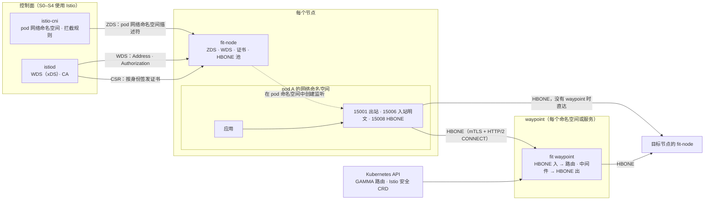

# fit 服务网格数据面路线图

[English](mesh-roadmap.md) | [简体中文](mesh-roadmap.zh-CN.md)

本路线图规划 fit 作为现代云原生服务网格的数据面：无 sidecar（ambient）架构下的节点四层代理和七层
waypoint 代理。它是 [网关路线图](roadmap.zh-CN.md) 之外的一条独立路线，复用网关的数据面，但有自己的里程碑、
退出标准和 [开发计划](mesh-dev-plan.zh-CN.md)。

与网关路线图一样，文中不写日期：里程碑在满足退出标准时结束。[开发规则](rules.zh-CN.md) 对这里的每个改动同样适用。

- [为什么做](#为什么做)
- [选型：先做 ambient](#选型先做-ambient)
- [目标](#目标)
- [非目标](#非目标)
- [设计原则](#设计原则)
- [架构](#架构)
- [与网关路线图的关系](#与网关路线图的关系)
- [里程碑](#里程碑)
  - [S0 前提与基线](#s0-前提与基线)
  - [S1 身份与 HBONE](#s1-身份与-hbone)
  - [S2 节点代理](#s2-节点代理)
  - [S3 Waypoint](#s3-waypoint)
  - [S4 运维与韧性](#s4-运维与韧性)
  - [S5 独立模式与多网络](#s5-独立模式与多网络)
  - [网格 1.0](#网格-10)
- [需要 fib 提供的能力](#需要-fib-提供的能力)
- [性能目标](#性能目标)
- [风险与待定问题](#风险与待定问题)

## 为什么做

网格数据面的成本主要是每个连接、每个 pod 的内存和 CPU，以及升级时对业务连接的扰动。fib 的事件循环模型
（每个连接没有 goroutine、空闲连接占用很小、背压内建）正好针对这些成本。现在主流的数据面各有取舍：

| 数据面 | 形态 | 长处 | 短处 |
| --- | --- | --- | --- |
| Envoy（Istio sidecar） | 每个 pod 一个 sidecar | 功能最全，xDS 是事实标准 | 每个 pod 都付一份内存；配置面极大；升级要重启 pod |
| ztunnel（Istio ambient） | 每个节点一个四层代理，七层交给 waypoint | 资源省，升级不重启业务 pod，协议（HBONE、WDS）小而公开 | 只做四层；七层仍是 Envoy |
| Linkerd2-proxy | 每个 pod 一个 Rust 微代理 | 轻量、默认 mTLS、协议检测 | 只配合 Linkerd 控制面，扩展性有限 |
| Cilium | eBPF 加每节点 Envoy | 内核态转发快 | 七层仍是 Envoy；与 CNI 绑定 |

fit 的机会在 ambient 架构的两个位置：替换 ztunnel 的节点代理，以及作为 waypoint 的七层代理。两者都是
少量实例承载大量连接的形态，正是 fib 的长处；waypoint 还能直接复用 fit 网关已有的路由和中间件。

## 选型：先做 ambient

- **先 ambient，后 sidecar。** ambient 是 Istio 的发展方向，节点代理的协议面（ZDS、WDS、HBONE、CA）远小于
  Envoy 的 xDS，能在可控的工作量内做到与 Istio 互通。sidecar 模式放到 S5 再评估。
- **先对接 Istio，后独立运行。** 控制面、CA 和 CNI 先使用 Istio 现成的 istiod 和 istio-cni，fit 只做数据面。
  不依赖 Istio 的独立模式在 S5。
- **七层不走 Envoy xDS。** fit waypoint 从 Kubernetes Gateway API（GAMMA）和 Istio 的安全 CRD 取配置，经
  网关路线图 M4 的 Kubernetes provider 编译成 fit 原生配置，而不是实现 Envoy 的 LDS/RDS/CDS/EDS。

## 目标

1. **fit-node 可以直接替换 ztunnel。** 同一个 Istio 版本、同一套 istiod 和 istio-cni，换镜像即可；
   Istio ambient 集成测试中四层部分通过。
2. **fit waypoint 可以作为 Istio 的第三方 waypoint。** 通过 GAMMA 一致性测试的 mesh profile，并支持
   AuthorizationPolicy 和 RequestAuthentication 的七层语义。
3. **在 ztunnel 的强项上不输，在 Envoy waypoint 上明显更省。** 数字见 [性能目标](#性能目标)。
4. **升级、证书轮换、配置变化都不断开业务连接。**

## 非目标

- **CNI 和流量拦截。** 拦截规则由 istio-cni（或兼容实现）在 pod 网络命名空间中设置；fit 不做 CNI 插件，也不写
  eBPF 程序。
- **自己的 CA 和完整控制面。** S0–S4 使用 istiod；S5 的 fit-meshd 只提供工作负载发现，身份交给 istiod 或 SPIRE。
- **兼容 Envoy xDS 的全部或大部分。** 见 [选型](#选型先做-ambient)。
- **七层协议过滤器**（Redis、Kafka、Mongo、Dubbo、Thrift）和 Lua、EnvoyFilter 式的配置补丁。
- **Linux 以外的平台。** 网格数据面依赖网络命名空间、`SO_ORIGINAL_DST`、`IP_TRANSPARENT` 等 Linux 能力，
  只在 Linux 上构建和运行。

## 设计原则

网关路线图的 [设计原则](roadmap.zh-CN.md#设计原则) 全部适用，另加以下几条：

1. **网络命名空间操作放在独立的池里。** 进入 pod 网络命名空间（`setns`）需要锁定 OS 线程，属于阻塞操作；
   它只在一个有上限的专用池里创建 socket，再把描述符交给 fib，worker 从不进入其他命名空间（规则 4）。
2. **身份是一等公民。** 每个隧道都带着源和目标的 SPIFFE 身份；授权、指标和日志都以身份为主键，而不是 IP。
3. **每个 pod、每个身份的资源都有上限**：连接数、隧道数、证书数、待发字节。一个 pod 的流量不能耗尽节点代理
   给其他 pod 的资源（规则 11）。
4. **工作负载视图是不可变快照。** 与网关的运行时图一样，xDS 更新在控制面编译成新快照后原子替换，数据面只读。
5. **默认 mTLS。** 网格内的流量默认走 HBONE 加 mTLS；明文只用于明确标记为网格外的目标。

## 架构

- **fit-node**（节点代理，DaemonSet）：从 istio-cni 经 ZDS 收到每个 pod 的网络命名空间，在其中创建 15001、15006、
  15008 三个监听；出站连接按原始目标地址查 WDS 快照，选出端点后经 HBONE 发往目标节点或 waypoint；入站 HBONE
  终结后连接到 pod 中的应用，并保留原始源地址。
- **fit waypoint**（七层代理，Deployment）：在 15008 接受 HBONE，解出内部的 HTTP、gRPC 流量，走 fit 的路由和
  中间件，再经 HBONE 发往目标端点。
- **身份**：fit-node 代表节点上的每个服务账号向 CA 申请证书，按身份缓存并在过半有效期时轮换。

## 与网关路线图的关系

| 网格需要 | 来自网关路线图 |
| --- | --- |
| 原生配置、运行时图、原子替换 | M0（已完成） |
| 上游连接池、负载均衡、健康检查、指标 | M1、M2（已完成） |
| 匹配器、重写、限流、认证、重试、熔断、流量拆分 | M3 |
| TCP 代理与背压 | M3 I50 |
| gRPC 代理（xDS 客户端也用 fib 的 gRPC） | M3 I49 |
| Kubernetes provider、Gateway API | M4 I56、I58、I59 |
| OpenTelemetry | M4 I65 |

S0–S2（身份、HBONE、节点代理）只依赖 fit 已有的核心和 fib，可以与 M3 并行；S3（waypoint）在 M3 和 M4 的
Kubernetes provider 之后。

## 里程碑

每个里程碑列出 **范围**、**退出标准** 和依赖的 **fib 能力**；fib 能力的编号见
[需要 fib 提供的能力](#需要-fib-提供的能力)。

### S0 前提与基线

**范围**

- 决定说明：ambient 优先、对接的 Istio 版本范围、protobuf 和 gRPC 相关依赖（规则 14）、waypoint 走 GAMMA
  而不是 Envoy xDS。
- `mesh/` 包骨架，只在 Linux 上构建；`cmd/fit` 增加 `fit node` 子命令。
- 测试环境：CI 中的 kind 加 Istio ambient；基准主机上基于网络命名空间（`ip netns`）的多 pod 模拟环境，
  不需要 Kubernetes。
- 基线：在基准主机上测 ztunnel（本地配置模式）和直连的吞吐、延迟、每连接内存。
- 把 F1–F5 写进 [fib-api-requests](fib-api-requests.zh-CN.md)。

**退出标准**

- 决定说明和 fib 需求已提交；ztunnel 基线结果已提交。

**fib 能力**：无新增。

### S1 身份与 HBONE

**范围**

- SPIFFE 身份：解析和校验 SPIFFE ID、trust domain；按身份缓存证书，有数量上限，过半有效期时轮换。
- Istio CA 客户端：经 gRPC 向 istiod 申请证书，代表节点上的服务账号签发。
- HBONE 服务端：15008 上的 mTLS 加 HTTP/2 CONNECT，校验对端身份，把每个 CONNECT 流接到目标并双向背压。
- HBONE 客户端：按（源身份、目标地址、目标身份）复用的 HTTP/2 连接池，每个连接上的流有上限。

**退出标准**

- fit 的 HBONE 客户端和服务端与真实 ztunnel 双向互通。
- 证书轮换期间已建立的隧道不断开。

**fib 能力**：F1（HTTP/2 客户端 CONNECT 流）、F5（按连接选择客户端证书和校验 SPIFFE）。

### S2 节点代理

**范围**

- xDS 客户端：基于 fib gRPC 的 delta ADS，有资源数上限，处理 NACK。
- 工作负载发现（WDS）：`Address`（Workload、Service）和 `Authorization` 资源，编译成按 IP、服务 VIP 索引的
  不可变快照。
- ZDS：经 Unix socket 从 istio-cni 接收 pod 的网络命名空间描述符；在专用池中进入命名空间创建监听，pod 删除时
  排空并关闭。
- 出站：15001 取原始目标地址，查快照，选端点，经 HBONE 直达目标节点或 waypoint；网格外目标透传。
- 入站：15008 终结 HBONE 后以原始源地址连接应用；15006 处理入站明文并执行策略。
- 四层授权：按命名空间、身份、端口、IP 的 ALLOW 和 DENY。
- 四层遥测：带 Istio 标准标签的 `istio_tcp_*` 指标和连接日志，标签基数有上限。

**退出标准**

- 在 kind 中用 fit-node 替换 ztunnel 后，bookinfo 正常工作，Istio ambient 集成测试的四层部分通过。
- 在基准主机上与 ztunnel 对比吞吐、延迟和每连接内存，结果已提交。

**fib 能力**：F2（接管已有的监听描述符）、F3（用预先创建的 socket 拨号，设置 `SO_MARK`、
`IP_TRANSPARENT`）、F4（取得接受连接的原始目标地址）。

### S3 Waypoint

**范围**

- `fit-waypoint` GatewayClass：带 HBONE 监听的 Gateway，由 istiod 在 WDS 中把服务指向它。
- 数据路径：HBONE 入，按内部请求走 fit 的路由和中间件，再以 HBONE 发往端点，保留源身份。
- GAMMA：以 Service 为 parentRef 的 HTTPRoute、GRPCRoute。
- 七层安全：AuthorizationPolicy 的七层规则、RequestAuthentication（JWT），映射到 M3 的认证和授权中间件。
- 七层遥测：`istio_requests_total` 等标准指标，链路追踪传播。

**退出标准**

- 通过 Gateway API 一致性测试中 GAMMA 的 mesh profile。
- Istio 中 waypoint 相关集成测试的选定子集通过。
- 在基准主机上与 Envoy waypoint 对比，结果已提交。

**fib 能力**：F1；其余沿用网关的能力。

### S4 运维与韧性

**范围**

- 节点代理无中断升级：新实例经 ZDS 重新取得各 pod 的命名空间，在其中用 `SO_REUSEPORT` 创建监听，旧实例排空。
- 过载保护：每个 pod 的连接和隧道上限、节点级内存水位、分级的拒绝动作。
- DNS 代理（可选）：在 pod 中拦截 DNS，用 WDS 中的服务名直接应答，其余异步转发。
- 调试接口：配置快照、工作负载和证书列表；`fit mesh` 命令行。
- 打包：镜像，以及替换 Istio ztunnel chart 中镜像的说明。

**退出标准**

- 在持续流量下升级 fit-node，已建立的连接不断开，新连接不失败。
- 一个 pod 发起大量连接时，同节点其他 pod 的延迟保持在上限之内。

**fib 能力**：F2。

### S5 独立模式与多网络

**范围**

- fit-meshd：轻量控制面，从 Kubernetes API 直接生成 WDS，不需要 istiod。
- SPIRE 身份：经 SPIFFE Workload API（Delegated Identity）为节点上的工作负载取得证书。
- 多网络：经东西向网关的双层 HBONE。
- sidecar 模式：评估并写决定说明，结论可能是不做。

**退出标准**

- 不安装 Istio，只用 fit-meshd 和 SPIRE，bookinfo 在 mTLS 下工作。
- 两个网络之间的服务可以互访。

**fib 能力**：嵌套隧道（HBONE 套 HBONE）如有缺口，届时补充。

### 网格 1.0

- 发布与 Istio 版本的兼容矩阵，CI 中按矩阵持续跑互通测试。
- 对 HBONE、证书处理和 ZDS 的外部安全审计。
- 文档：安装、从 ztunnel 和 Envoy waypoint 迁移、排障。

## 需要 fib 提供的能力

以下是候选需求，S0 时按 [开发规则](rules.zh-CN.md) 第 15 条写进 fib-api-requests 并编号：

| 编号 | 需求 | 用途 |
| --- | --- | --- |
| F1 | HTTP/2 客户端发起 CONNECT 和扩展 CONNECT，每个流作为一个 `Tunnel`，带流控和背压；一个连接上多个隧道 | HBONE 客户端、waypoint 出站 |
| F2 | 把已有的监听描述符作为 binding 加入引擎，并能移除和排空 | 在 pod 命名空间中监听；无中断升级 |
| F3 | 用调用方预先创建的 socket 拨号，以及拨号前设置 socket 选项（`SO_MARK`、`IP_TRANSPARENT`、绑定源地址） | 在 pod 命名空间中出站；保留原始源地址 |
| F4 | 在接受的连接上取得原始目标地址（`SO_ORIGINAL_DST`、`IP6T_SO_ORIGINAL_DST`） | 出站 15001 |
| F5 | 客户端按连接选择证书；对端证书校验的回调能拿到 URI SAN | 按身份建立 mTLS |

## 性能目标

所有数字都来自基准主机（规则 16–18）。基线在 S0 测得。

| 指标 | 目标 |
| --- | --- |
| 节点代理每条隧道连接的内存 | 不高于 ztunnel |
| 节点代理吞吐和 p99 延迟增量 | 与 ztunnel 相当 |
| waypoint 每请求 CPU 和内存 | 明显低于 Envoy waypoint |
| 新隧道建立延迟（池中已有连接） | 一次往返之内 |
| 证书轮换、配置更新、升级 | 不断开已建立的连接 |

## 风险与待定问题

- **Istio 内部协议会变。** ZDS 和 WDS 的消息定义随 Istio 版本演进，并非稳定的公开 API。对策：固定支持的版本
  范围，协议定义从 Istio 仓库生成，CI 按兼容矩阵跑互通测试。
- **第三方 waypoint 的支持程度。** istiod 是否、以及如何把服务指向非 Istio 类的 waypoint，要在 S0 对照 Istio
  源码和已有的第三方实现确认；若受限，S3 改为由 fit-meshd 提供 WDS。
- **protobuf 依赖。** xDS 和 CA 需要 protobuf；`google.golang.org/protobuf` 会增加二进制体积。只在 `fit node`
  和 waypoint 需要的包中引入，并写决定说明。
- **网络命名空间与 Go 运行时。** `setns` 要求锁定线程并在操作后恢复或丢弃该线程；做错会让其他 goroutine 跑在
  错误的命名空间里。专用池、锁线程和丢弃线程的做法要有测试覆盖。
- **测试成本。** 网格的端到端测试需要 kind 和 Istio，耗时长；按 [开发规则](rules.zh-CN.md) 第 20 条只在相关改动
  上运行，完整矩阵放在 CI 定时任务中。
- **基准环境。** 基准主机上没有 Kubernetes；性能对比使用网络命名空间模拟的 pod，与真实集群的差异记录在结果旁。
