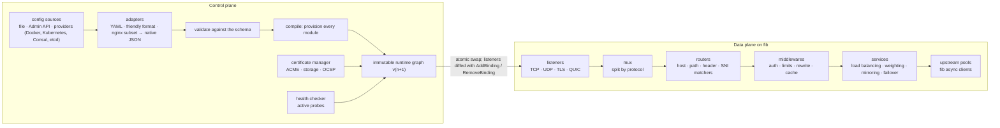

# fit roadmap

[English](roadmap.md) | [简体中文](roadmap.zh-CN.md)

fit is a reverse proxy, load balancer, TLS terminator, static file server and API gateway built on
[fib](https://github.com/lesismal/fib). This roadmap turns the conclusions of
[nginx, Caddy and Traefik compared](comparison.md) into milestones: what each one delivers, how we
know it is done, and which part of fib it builds on.

fit is at the planning stage: there is no code yet. The order of the milestones is firm; their
contents will move as the work teaches us things. Dates are left out on purpose, because a
milestone ends when its exit criteria are met, not when a calendar says so.

- [Goals](#goals)
- [Non-goals](#non-goals)
- [Design principles](#design-principles)
- [Architecture](#architecture)
- [Milestones](#milestones)
  - [M0, foundations](#m0-foundations)
  - [M1, the proxy core](#m1-the-proxy-core)
  - [M2, dynamic config and TLS](#m2-dynamic-config-and-tls)
  - [M3, gateway features](#m3-gateway-features)
  - [M4, platform integration](#m4-platform-integration)
  - [M5, caching and extensions](#m5-caching-and-extensions)
  - [1.0](#10)
- [Feature map](#feature-map)
- [Performance targets](#performance-targets)
- [Risks and open questions](#risks-and-open-questions)

## Goals

The comparison shows that each of the three is strong where another is weak. fit aims to hold the
strengths of all three at once:

| Compared with | What fit keeps from it | Where fit should be better |
| --- | --- | --- |
| nginx | event loops, a small footprint per idle connection, strong static files and caching | config changed in process with no reload; automatic HTTPS, active health checks, dynamic upstreams and full metrics in the open source build; extensions that are memory-safe |
| Caddy | HTTPS by default, a strict programmable native config, an Admin API with atomic swaps, one static binary | memory and GC per connection; caching, rate limiting and layer 4 proxying built in rather than left to plugins |
| Traefik | the entryPoint → router → middleware → service model, providers, operations built in | static files and caching; speed and memory; one place to read the effective config |

On top of that, fib gives fit two things none of the three has: several protocols on one port
(`mux`, `multiproto`) and a built-in SOCKS proxy.

## Non-goals

- **A mail proxy.** nginx's `mail` module has few users today; fit leaves it out.
- **A service mesh.** fit is an edge and gateway proxy, not a sidecar, and it does not try to
  replace Envoy or Linkerd inside a cluster.
- **API management.** Developer portals, API monetisation and API key self-service belong in tools
  that sit on top of a gateway.
- **Compatibility with Lua, njs or Yaegi plugins.** fit's runtime extensions are WASM.
- **Full nginx config compatibility.** The converter in M5 covers a common subset to ease
  migration, not every directive.

## Design principles

These come from the [design recommendations](comparison.md#design-recommendations) in the
comparison. Every milestone is reviewed against them.

1. **The data plane keeps fib's model.** No goroutine per connection or per request on the request
   path. Anything that must block (external auth, JWKS fetches, plugin calls, disk cache misses)
   runs on a pool of its own, and waits between pools go only one way so the pools cannot
   deadlock each other.
2. **The control plane and the data plane are separate.** Config parsing, provider watches,
   certificate issuance and health probes live in the control plane and produce immutable runtime
   objects. The data plane only reads them, through one atomic pointer.
3. **One concept model for every protocol**: listener → router → middleware → service → upstream,
   the same for HTTP, TCP and UDP, with fib's `mux` letting a listener split traffic by protocol
   first.
4. **Safe defaults**, as Caddy has: HTTPS on, modern TLS parameters, HTTP redirected to HTTPS,
   limits on header and body sizes, the Admin API bound to localhost or a Unix socket.
5. **nginx's bar for speed, static files and caching.** Each milestone publishes benchmarks against
   nginx, Caddy and Traefik; a regression is a bug.
6. **Lean dependencies.** The core depends on fib and the standard library. A third-party library
   comes in only where writing our own would be much worse (ACME, WASM runtime), and only behind
   an interface of fit's own.

## Architecture

A request is served entirely by the graph it started on. A new graph only affects requests and
connections that arrive after the swap; long-lived connections (WebSocket, gRPC streams, TCP
tunnels) stay on the old graph until they end or a configurable drain timeout closes them.

## Milestones

Each milestone lists its **scope**, the **exit criteria** that end it, and the **fib parts** it
leans on. Releases are numbered 0.x until 1.0; each milestone ends in a release.

### M0, foundations

The skeleton every later milestone builds on, plus the means to measure it.

**Scope**

- Repository layout: `cmd/fit`, the core packages, CI with race detection, linting and fuzzing.
- The core abstractions: listener, router, matcher, middleware, service and upstream interfaces,
  and the module registry that config names resolve to.
- The runtime graph: compile from config, swap through an atomic pointer, reference-count graphs so
  an old graph is released when its last connection ends.
- The native config format: JSON, with a published JSON Schema; `fit validate` and `fit run`.
- A benchmark harness that runs nginx, Caddy, Traefik and fit with equivalent configs under the
  same load generators (wrk, h2load, a WebSocket and an HTTP/3 client) and records throughput,
  latency percentiles, memory and CPU.

**Exit criteria**

- `fit run -c fit.json` serves a fixed response on HTTP/1.1 and HTTP/2.
- The harness has baseline numbers for nginx, Caddy and Traefik, checked into the repository.

**fib parts**: the engine, `AddBinding`, the HTTP/1.x and HTTP/2 servers.

### M1, the proxy core

fit becomes usable as a reverse proxy and a static file server.

**Scope**

- **Entry points**: HTTP/1.1, HTTP/2 (TLS and h2c) and HTTP/3; TLS with certificates from files;
  graceful shutdown.
- **Static files** on `http.FileCache` and sendfile: precompressed twins, range requests, index
  files, `try_files`-style fallbacks, ETag and `Last-Modified`.
- **Reverse proxy**, written for fib rather than on `httputil.ReverseProxy`:
  - upstream connection pools on fib's asynchronous HTTP/1.x and HTTP/2 clients;
  - request and response bodies streamed both ways, with backpressure linked across the two sides
    (`HoldReads` on the upstream while the client is slow, and the other way round);
  - connect, header and idle timeouts; cancellation carried by `c.Context()` when the client goes
    away;
  - hop-by-hop headers removed, `X-Forwarded-*` and `Forwarded` set, with a trusted-proxy list.
- **Load balancing**: round robin, weighted round robin, least connections.
- **Passive health checks**: an upstream is marked down after N failures within a window, as
  nginx's `max_fails` / `fail_timeout`.
- **Access logs**: structured JSON, buffered, written off the event loop.
- **Reload on SIGHUP**: build a new graph in process and swap it; listeners whose address is
  unchanged are kept. This stands in for the Admin API until M2.

**Exit criteria**

- h2spec passes on the HTTP/2 entry point; a proxy conformance suite (headers, bodies, trailers,
  timeouts, client aborts) passes on HTTP/1.1 and HTTP/2.
- Benchmarks published for static files and for proxying, against the M0 baselines.
- Memory per idle connection measured at 10k and 100k connections and compared with the three.

**fib parts**: the HTTP/1.x, HTTP/2 and HTTP/3 servers and clients, `http.FileCache`, sendfile,
`Connection.HoldReads`, the Router.

### M2, dynamic config and TLS

Config changes without dropping anything, and HTTPS with no manual steps.

**Scope**

- **Admin API** (REST, on localhost or a Unix socket by default, with optional auth):
  load a whole config, read it, patch it by path, roll back to an earlier version; configs carry a
  version and an ETag so concurrent writers cannot overwrite each other.
- **Atomic swaps**: a new config is provisioned completely before the swap; a failure leaves the
  running config untouched. Listeners are diffed: new addresses through `AddBinding`, removed ones
  drained through `ShutdownBinding`.
- **File provider**: watch the config file and apply changes through the same path as the API.
- **Automatic HTTPS**:
  - ACME with HTTP-01 and TLS-ALPN-01 challenges, renewal ahead of expiry, OCSP stapling;
  - HTTPS on and HTTP redirected by default for every host name in the config;
  - certificate storage behind an interface, with a file system implementation;
  - on-demand TLS, guarded by an "ask" endpoint and rate limits so it cannot be abused.
- **Active health checks**: HTTP and TCP probes, with intervals, thresholds and jitter.
- **More load balancing**: random, P2C (power of two choices), consistent hashing on IP, header,
  cookie or URI, sticky sessions by cookie.
- **Prometheus metrics**: per router, service and upstream; connection and pool gauges; config
  reload and certificate expiry metrics.

**Exit criteria**

- A churn test (thousands of config swaps while traffic runs) drops no connection and fails no
  request.
- A site with only a host name in its config gets a certificate from the Let's Encrypt staging
  environment and serves HTTPS.
- An upstream that stops answering probes leaves rotation within the configured window and comes
  back after it recovers.

**fib parts**: `AddBinding`, `RemoveBinding`, `ShutdownBinding`, `fib/tls` and the
`GetCertificate` callback on the handshake pool.

### M3, gateway features

What turns a reverse proxy into an API gateway, and layer 4.

**Scope**

- **Matchers**: host, path (prefix, exact, regexp), method, header, query, remote IP and CIDR, and
  an expression language that combines them; explicit priorities, no implicit ordering.
- **Rewrites and headers**: path rewrites, prefix stripping, redirects, request and response header
  changes.
- **Limits**: rate limits by key (token bucket, local to the instance), concurrency limits,
  request size limits.
- **Authentication**: Basic, ForwardAuth (the auth call runs asynchronously; the request waits
  without holding a worker), JWT with JWKS fetched and cached by the control plane, mTLS client
  certificates.
- **Resilience**: retries with budgets and idempotency rules, circuit breakers, per-route
  timeouts.
- **Traffic splitting**: weighted services, mirroring, failover services.
- **Compression**: gzip, zstd and brotli, negotiated per request, skipping already compressed types.
- **WebSocket proxying** through `Context.Upgrade` and `Tunnel`, including WebSocket over HTTP/2
  and HTTP/3 entry points with HTTP/1.1 upstreams.
- **gRPC proxying**: h2c and TLS upstreams, trailers, deadlines carried through.
- **Layer 4**: TCP and UDP proxying, routing by SNI without terminating TLS, PROXY protocol v1/v2
  in and out, and protocol-based routing on one port through `mux` — HTTP, TLS, gRPC, SOCKS and
  custom protocols side by side.
- **Upstream TLS**: mTLS to upstreams, custom CAs, SNI overrides.

**Exit criteria**

- Each middleware has a conformance test and a benchmark; none puts a blocking call on a worker.
- WebSocket, gRPC (unary and streaming) and TCP/UDP proxying pass end-to-end tests, including
  backpressure under slow peers.
- A single port serves HTTP/1.1, HTTP/2, TLS passthrough by SNI and SOCKS at once.

**fib parts**: `mux`, `multiproto`, raw TCP/UDP handlers, `Connection.SetHandler`,
`Context.Upgrade`, `Tunnel`, the WebSocket and gRPC packages, `socks`, `ConnectProxy`, the
compress, cors and limiter middleware as starting points.

### M4, platform integration

fit in container platforms, as Traefik is.

**Scope**

- **Providers**, each feeding the same compile path as the file and the API:
  - Docker, with labels as config;
  - Kubernetes Gateway API (HTTPRoute, GRPCRoute, TLSRoute, TCPRoute, UDPRoute), and Ingress for
    clusters that still use it;
  - Consul and etcd, for service catalogues and KV config.
- **Merging rules** that are written down and visible: which source wins, and a read-only Admin
  API endpoint that shows the effective config and where each part came from.
- **Clustering**: shared certificate storage (Redis, etcd, Consul) with locks, so several instances
  share issuance and renewal.
- **Dashboard**: read-only, showing routers, services, upstream health, certificates and recent
  config versions.
- **OpenTelemetry**: tracing with context propagated to upstreams; metrics exported over OTLP as
  well as Prometheus.
- **Packaging**: container images, a Helm chart, systemd units.

**Exit criteria**

- fit passes the Kubernetes Gateway API conformance suite for the core profile it claims.
- A Docker Compose example routes services by their labels and follows them as they start and stop.

**fib parts**: nothing new; this milestone is control plane work.

### M5, caching and extensions

Where nginx is still ahead of the Go servers, and the extension story.

**Scope**

- **Response cache**:
  - HTTP caching semantics (RFC 9111): `Cache-Control`, `Vary`, validators, `Age`;
  - a memory tier and a disk tier, with disk I/O kept off the event loop;
  - cache locks so one miss fetches from upstream while the others wait;
  - stale-while-revalidate and stale-if-error;
  - purging by key and by tag through the Admin API.
- **Compile-time Go modules**: a `fit build` command, like xcaddy, for handlers where speed matters.
- **WASM plugins**: loaded at run time, sandboxed, run on a pool of their own; a pure-Go runtime
  (such as wazero) so the binary stays static; the Proxy-Wasm ABI considered so existing filters
  can be reused.
- **Config adapters**: a human-friendly config format, and a converter for a common subset of
  nginx configs that reports what it could not convert.
- **FastCGI**, so PHP sites can move from nginx or Caddy.

**Exit criteria**

- The cache matches nginx's `proxy_cache` on hit-ratio scenarios in the benchmark harness and
  survives a stampede test (many clients, one cold key) with one upstream fetch.
- A WASM plugin that edits headers adds a bounded, measured cost per request.
- The nginx converter handles the sample configs in its test suite and lists every directive it
  skipped.

**fib parts**: `sidepool` / `streampool` style pools for blocking work, `http.FileCache` as a
model for the memory tier.

### 1.0

1.0 is a promise of stability, not a feature list.

- The native config schema and the Admin API are versioned as v1; breaking changes after that need
  a new major version and a migration path.
- Fuzzing runs continuously on the parsers, the proxy and the config compiler.
- An external security review of TLS handling, the Admin API and the plugin sandbox.
- Documentation: a getting started guide, a full config reference, and migration guides from
  nginx, Caddy and Traefik.

## Feature map

The rows follow the [feature table](comparison.md#features) in the comparison.

| Feature | Milestone | Built on in fib |
| --- | --- | --- |
| HTTP/1.1, HTTP/2 | M1 | HTTP/1.x and HTTP/2 servers |
| HTTP/3 (QUIC) | M1 | `http3` |
| h2c upstreams / gRPC proxying | M1 (h2c), M3 (gRPC) | HTTP/2 client, `grpc` |
| WebSocket proxying | M3 | `Context.Upgrade`, `Tunnel`, `websocket` |
| TCP/UDP layer 4 proxying | M3 | raw TCP/UDP handlers, `HoldReads` |
| TLS routing by SNI | M3 | `mux`, `fib/tls` |
| Several protocols on one port | M3 | `mux`, `multiproto` |
| SOCKS and CONNECT forward proxying | M3 | `socks`, `ConnectProxy` |
| Static files | M1 | `http.FileCache`, sendfile |
| FastCGI | M5 | — |
| Load balancing: round robin, weighted, least connections | M1 | — |
| Load balancing: random, P2C, hashing, sticky sessions | M2 | — |
| Active health checks | M2 | async clients |
| Passive health checks | M1 | — |
| Dynamic upstreams | M2 (API), M4 (providers) | — |
| Response caching | M5 | — |
| Rate and concurrency limits | M3 | `limiter` middleware |
| Authentication: Basic, ForwardAuth, JWT, mTLS | M3 | `fib/tls` |
| Rewrites and redirects | M3 | Router |
| Compression: gzip, zstd, brotli | M3 | `compress` middleware |
| Automatic HTTPS (ACME), on-demand TLS | M2 | `GetCertificate` on the handshake pool |
| Config changes without interruption | M1 (SIGHUP), M2 (Admin API) | `AddBinding`, `RemoveBinding`, `ShutdownBinding` |
| Kubernetes Gateway API, Ingress | M4 | — |
| Docker service discovery | M4 | — |
| Prometheus metrics | M2 | — |
| OpenTelemetry tracing | M4 | — |
| Dashboard | M4 | — |
| Structured logs | M1 | — |
| Extensions: Go modules, WASM | M5 | — |
| nginx config converter | M5 | — |

## Performance targets

Performance is the reason fit is built on fib, so it is tracked from M0 on, not tuned at the end.
Exact numbers are fixed once M0 has baselines on the same hardware; the targets below say where
fit must land relative to the others.

| Metric | Target |
| --- | --- |
| Memory per idle connection (HTTP/1.1 keep-alive, TLS, WebSocket) | close to nginx; well below Caddy and Traefik |
| Throughput, static files | at least Caddy's; within reach of nginx |
| Throughput, reverse proxy | above Caddy and Traefik |
| p99 latency under load | no worse than Caddy and Traefik; flat while config is being swapped |
| GC pause and allocations per request | measured per release; increases need a reason |
| Cost of a config swap | independent of the number of open connections |

The benchmark harness runs in CI on every release and on any change to the data plane; results are
published in the repository with the hardware and configs used.

## Risks and open questions

- **ACME library.** CertMagic is the most complete but brings Caddy's assumptions; lego is a client
  only; writing our own keeps dependencies lean but is a lot of work to get right. Decide in M2,
  behind fit's own certificate manager interface so the choice can change.
- **Config formats.** JSON is the native format; whether the human-friendly format is YAML, a
  Caddyfile-like syntax or something else is open until M5. The schema must be stable well before
  that, because providers and the Admin API depend on it.
- **Gaps in fib.** fib has no `http.Hijacker`, and `Request.Context()` is not cancelled when the
  client leaves, so standard-library proxies and some middleware cannot be reused as they are. fit
  works around this with fib's own APIs; anything missing from fib is raised there rather than
  patched around in fit.
- **Blocking extension points.** ForwardAuth, JWKS, WASM and disk caching all want to block. Each
  needs its own pool and a timeout, and the pools need a fixed waiting order. Getting this wrong
  costs throughput or deadlocks under load, so each one comes with a load test that saturates it.
- **Gateway API conformance.** The suite is large and changes with each Gateway API release; M4
  should claim a narrow profile first and grow it.
- **WASM cost.** Calls across the WASM boundary and memory copies may make plugins too slow for
  hot paths. M5 measures this before committing to the Proxy-Wasm ABI.
- **Distributed state.** Rate limits and caches are local to one instance in this roadmap. Sharing
  them across a cluster (Redis or a gossip protocol) is left for after 1.0 unless users need it
  sooner.
